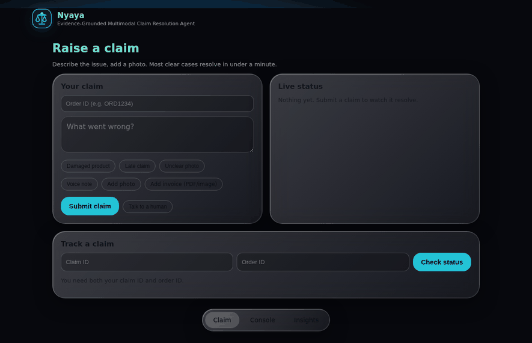
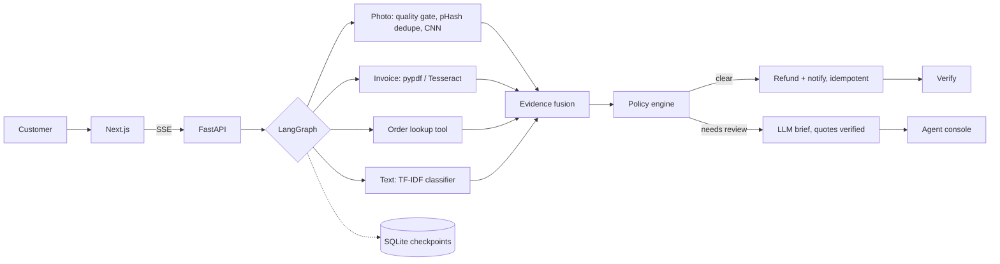

<p align="center"></p>

<h1 align="center">Nyaya</h1>
<p align="center">Evidence-grounded multimodal claim resolution agent</p>

<p align="center">
<a href="https://github.com/lakshaysharmaug22-crypto/Nyaya-Evidence-Grounded-Multimodal-Claim-Resolution-Agent/actions/workflows/eval.yml"></a>
<a href="https://nyaya-evidence-grounded-multimodal.vercel.app"></a>


</p>

<p align="center">
<a href="https://nyaya-evidence-grounded-multimodal.vercel.app"><b>Live demo</b></a> &nbsp;|&nbsp;
<a href="https://nyaya-evidence-grounded-multimodal.vercel.app/console">Agent console</a> &nbsp;|&nbsp;
<a href="docs/ARCHITECTURE.md">Architecture</a> &nbsp;|&nbsp;
<a href="https://nyaya-api-i7wt.onrender.com/ready">API health</a>
</p>

<p align="center"></p>

E-commerce support teams spend most of their time on damage and refund claims, and most of those claims are either obviously valid or obviously not. Nyaya automates the obvious ones and hands the rest to a person with the evidence already laid out.

A claim arrives with a photo, an invoice, an order ID and a description. Four checks run in parallel (image quality and duplicates, invoice OCR, order lookup, text classification), a rule-based policy makes the call, and refunds go through idempotent tools that survive a crash mid-run. When a case needs a human, an LLM drafts a short brief for the reviewer, and every quote in it is checked against the source documents before it is shown.

> The demo API runs on Render's free tier, so the first request after a quiet spell takes about 50 s. On `/console`, pick **Explore with sample data** to try the agent tools without a login.

## How it works



| Stage | What it does | Code |
| --- | --- | --- |
| Evidence | Photo, invoice, order and text checks fan out and run concurrently | `agent/graph.py` |
| Fusion | Cross-checks modalities: text says "damaged" but the photo shows nothing, invoice total or order ID doesn't match | `agent/graph.py` |
| Policy | 8 ordered rules: duplicate photo, unknown order, 7-day window, prompt injection, cross-modal mismatch, amount outlier, auto-approve, review | `agent/policy.py` |
| Brief | Review cases only. Structured output via LangChain; findings whose quotes aren't in the evidence are dropped | `agent/llm.py`, `agent/guard.py` |
| Action | Refund and notification through a tool registry with retries and persistent idempotency keys, also served over MCP | `agent/tools.py`, `mcp_servers/` |

## Engineering decisions

**The model advises, it never decides.** Refund decisions are money, so they come from rules that can be read, tested and audited. The LLM only summarises the evidence for a reviewer, and only on cases the rules route to review (about 60% of the regression set), which keeps cost down.

**Grounding is enforced, not prompted.** Every finding in the LLM brief has to carry a quote. `guard.is_grounded` checks that quote against the claim text and the OCR'd invoice, and anything that doesn't match is dropped before the reviewer sees it. Claim text is wrapped as untrusted input, and injection-style phrasing ("ignore previous instructions", "approve this") sends the claim straight to review.

**A crash can't refund twice.** The graph checkpoints to SQLite after every node, and tool calls carry idempotency keys stored in the same database. `tests/test_durability.py` simulates a crash right after the refund call, rebuilds the graph against the same database, resumes the run and asserts exactly one refund was issued.

**Customers can't score their own claims.** The scoring fields the eval harness uses (`damage_conf` and friends) were briefly accepted from the public endpoint. A request with `damage_conf: 0.99` would have been auto-approved with no photo at all. In production those fields are now stripped from any request without an agent token (`api/validate.py`, covered in `tests/test_hardening.py`).

**Search is FTS5, not embeddings.** Agents search by claim ID, order ID and phrases like "screen cracked". Exact and prefix matches matter more than semantic similarity here, and SQLite FTS5 handles that with filters (`decision:reject rule:duplicate_image`) and no extra service to run.

## Stack

| | |
| --- | --- |
| Agent | LangGraph (parallel fan-out, conditional routing, SQLite checkpointer), LangChain structured output, MCP server and client |
| ML | EfficientNet-B0 fine-tune exported to INT8 ONNX, TF-IDF + logistic regression, gradient boosting regressor, KMeans, perceptual hashing, Tesseract OCR, faster-whisper (optional) |
| Backend | FastAPI with server-sent events, SQLite (checkpoints, idempotency, FTS5 search) |
| Frontend | Next.js 14, live animated flow graph, glass UI that samples its tint from the background |
| Ops | Docker, Render, Vercel, GitHub Actions (tests, eval gate, ablation and web build on every merge) |

## Evaluation

```
python -m eval.run --gate     # CI regression gate against eval/baseline.json
python -m eval.ablation       # contribution of each evidence source
```

The regression set is 60 generated claims covering every policy path. The policy passes all of them, and CI blocks any merge that drops accuracy or verification rate or pushes p95 latency past the baseline. Since those labels come from the same rules as the policy, this is a regression test rather than an accuracy claim. The tabular models are trained and scored on synthetic claims for the same reason.

Real accuracy needs labelled data, so `eval/label.py` builds a gold set the proper way: two annotators label each case without seeing the system's output, Cohen's kappa is reported, disagreements are adjudicated with a written note, and the split is grouped by customer so nobody appears in both dev and test. The protocol is in [eval/gold/README.md](eval/gold/README.md). `python -m eval.run --set verified --llm` then reports accuracy per split along with LLM groundedness, tokens, cost and p50/p95 latency.

## Production hardening

- `NYAYA_ENV=production` refuses to start without a 16+ character agent token and an explicit CORS origin, and hides `/docs`
- Agent endpoints are token-gated with a constant-time compare; public endpoints are rate limited per IP
- Request bodies are size-capped and validated (IDs, text length, numeric ranges, base64)
- JSON logs carry request IDs and never request bodies; security headers are set on every response, and `/ready` reports component health
- Replies go out only after an agent approves the exact text, a real channel is configured and the recipient is on an allowlist. A retried send never goes out twice
- The trained CNN loads from a release URL and is rejected if its SHA-256 doesn't match, so no model binary sits in the repo
- 117 tests cover the graph, policy, durability, LLM guardrails, search and access control, hardening and the gold-set tooling

## Run it

```bash
sh scripts/bootstrap.sh            # venv and dependencies
python -m ml.train_tabular         # train the tabular models
uvicorn api.main:app --reload      # API on :8000
cd web && NEXT_PUBLIC_API_URL=http://localhost:8000 npm run dev    # UI on :3000
python -m pytest -q                # needs tesseract-ocr
```

Without `NEXT_PUBLIC_API_URL` the UI falls back to a built-in demo stream. Every setting is documented in [.env.example](.env.example).

Deploying: `render.yaml` is a Render Blueprint for the API (Docker, production mode, generated agent token), and the `web/` folder deploys to Vercel as-is.

## Roadmap

- Train the damage CNN on a public damaged/intact product dataset (`ml/notebooks/train_damage_kaggle.ipynb`). The pipeline is done; until weights are deployed, photo claims route to review
- Label about 100 real-evidence claims with the gold-set tooling and publish those numbers in place of the synthetic ones
- Run the live LLM eval for groundedness and cost per claim
- Move storage to Postgres and object storage for multi-instance deployments
