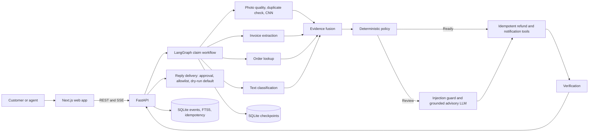
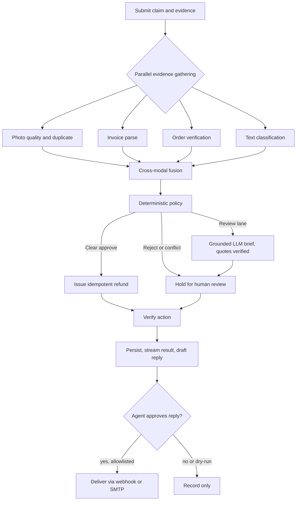

<p align="center"></p>

<h1 align="center">Nyaya</h1>
<p align="center"><b>Evidence-Grounded Multimodal Claim Resolution Agent</b><br>
LangGraph · FastAPI · Next.js · CNN · policy engine · grounded LLM · durable resume</p>

<p align="center"><b>Live app: pending first Vercel deployment</b> · <a href="docs/ARCHITECTURE.md">Architecture</a> · <a href="eval/gold/README.md">Gold-set protocol</a> · <a href="ml/README.md">ML</a></p>

Nyaya resolves customer damage claims from four kinds of evidence: the photo, the invoice, the order record and the customer's own words. The checks run in parallel. A deterministic policy engine makes the decision, and a language model only writes a brief for the cases a human must review. Every quote in that brief is checked verbatim against the evidence. Refunds are idempotent and survive crashes, and every merge runs the eval harness in CI.

## Status

| Area | State |
| --- | --- |
| Agent graph, policy engine, idempotent tools, crash-safe resume | Working, tested |
| Photo quality gate, duplicate-photo check, invoice OCR, text classifier, refund regressor | Working, tested |
| Console search, token-gated agent access, customer tracking, human handoff | Working; browser-tested locally |
| Reply delivery (webhook / SMTP) | Implemented and tested with mocks; **dry-run by default, never used against a live provider** |
| Production config: fail-fast settings, input validation, request IDs, security headers, JSON logs, `/ready` | Working, tested |
| Damage CNN | Training pipeline verified by a CPU smoke run; **not yet trained on real photos**. Photos score 0.0 and go to human review until it is |
| Live LLM briefs | Integration tested with a stub; **no live model run yet** (needs `ANTHROPIC_API_KEY`) |
| Human-verified gold set | Tooling and protocol ready; **0 cases labelled** |
| Web app on Vercel | Pending |

## Architecture





Components, data paths and trust boundaries: [docs/ARCHITECTURE.md](docs/ARCHITECTURE.md).

Design rules:
- **Policy decides, the model advises.** Only review-lane cases reach the LLM. It cannot change a decision or an amount, and findings whose quotes aren't in the evidence are dropped.
- **Customers can't score their own claims.** In production, model scores in a public request body are stripped. They come from the photo, invoice and order checks only.
- **No double refunds.** Idempotency keys live in SQLite, and the graph resumes from its last checkpoint after a crash.
- **Nothing is sent without approval.** A reply leaves only when an agent approves it, a real channel is configured and the destination is allowlisted.

## Results

Each row says what data it came from. None of these figures are human-verified or real-world.

| Measure | Result | Data |
| --- | ---: | --- |
| Decision accuracy (policy) | 100% | 60 synthetic regression cases, whose labels come from the same rules, so the check is circular |
| Verification rate | 100% | Same 60 synthetic cases |
| Claim-type macro F1 | 1.000 | 1,500 synthetic test rows |
| Refund MAE | ₹61.75 (baseline ₹1,188.59) | 1,500 synthetic test rows |
| p95 workflow latency | ~5 ms | Local CPU run, policy only, no LLM or CNN; not a production SLO |
| Tests | 117 passed | Local run |
| Damage CNN | Not trained on real data yet | See [ml/README.md](ml/README.md) |
| Live LLM (groundedness, cost, latency) | Not run yet | Reported by `python -m eval.run --set verified --llm` |
| Human-verified accuracy | Not measured yet | Protocol: [eval/gold/README.md](eval/gold/README.md) |

## Run locally

```
sh scripts/bootstrap.sh                     # venv, deps, git hooks
python -m ml.train_tabular                  # tabular models (synthetic data)
uvicorn api.main:app --reload               # API on :8000
cd web && NEXT_PUBLIC_API_URL=http://localhost:8000 npm run dev   # UI on :3000
python -m pytest -q                         # needs tesseract-ocr
python -m eval.run --gate                   # regression gate vs eval/baseline.json
```

Without `NEXT_PUBLIC_API_URL` the UI runs on a built-in demo stream, so `web/` works on Vercel by itself.

Pages: `/` customer claim, voice note and tracking · `/console` agent queue, search (`/` or Ctrl/Cmd+K), briefs, reply approval · `/console?demo=1` failure injection and replay · `/insights` metrics, drift, clusters, policy simulator, human-correction queue.

## Deploy

1. **Web on Vercel:** import this repo, set **Root Directory** to `web`, and deploy. Add `NEXT_PUBLIC_API_URL` once the API is up, then redeploy.
2. **API on Render:** New, then Blueprint, pointing at this repo (`render.yaml`). It runs with `NYAYA_ENV=production`, which refuses to start without `ALLOWED_ORIGINS` (your Vercel URL) and an `AGENT_TOKEN` of 16+ characters (generated for you). On the free plan, data resets on every deploy. Attach a disk and set `DATA_DIR` for durability.
3. **Optional:** `ANTHROPIC_API_KEY` for live briefs, `CNN_MODEL_URL` + `CNN_MODEL_SHA256` for the trained CNN, and `REPLY_MODE` + `REPLY_ALLOWLIST` + channel settings for delivery. Set all of them in the provider's secret settings, never in the repo.

Every variable is documented in [.env.example](.env.example).

## Evaluation

- `python -m eval.run --gate`: synthetic regression set. CI fails the merge on accuracy, verification or latency regressions.
- `python -m eval.run --set verified [--llm]`: human-verified gold set, reported by dev/test split, plus LLM provider, model, calls, errors, p50/p95 latency, tokens and cost.
- `python -m eval.label ...`: build that set. Two blind annotators, Cohen's kappa, adjudication, and a customer-grouped split. See [eval/gold/README.md](eval/gold/README.md).
- `python -m eval.ablation`: what each evidence source contributes.

## ML

- **Damage CNN:** EfficientNet-B0 fine-tune with a seeded, grouped split, held-out test metrics, INT8 ONNX export with a parity check, and a generated model card. Train it with `ml/notebooks/train_damage_kaggle.ipynb` on a free Kaggle GPU.
- **Tabular models:** TF-IDF + logistic regression claim type, gradient-boosting refund estimate, KMeans failure clusters. Trained on synthetic claims.
- **Image checks:** blur, brightness and size gate before upload, perceptual-hash duplicate detection.
- **Invoice extraction:** pypdf for PDFs and Tesseract for images.
- **Voice:** optional faster-whisper. Transcripts go through the same injection guard as typed text.

## Reply delivery

`POST /replies` with `approved: true` is the agent's sign-off on that exact text. Nothing is sent unless `REPLY_MODE` is `webhook` (HTTPS POST, optional HMAC signature, e.g. to n8n or a WhatsApp/SMS bridge) or `smtp`, and the destination matches `REPLY_ALLOWLIST`. A retry with the same `reply_id` never sends twice. The console shows exactly what happened: sent, dry-run, not allowlisted or failed.

## Repository rules

- Commits carry only the author's name. `.githooks/commit-msg` blocks AI attribution, and the `authors` workflow checks every PR and every push to `main`.
- Every merge runs the tests, the eval gate, the ablation and the web build (`.github/workflows/eval.yml`).
