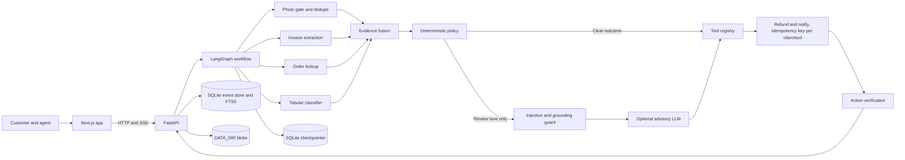
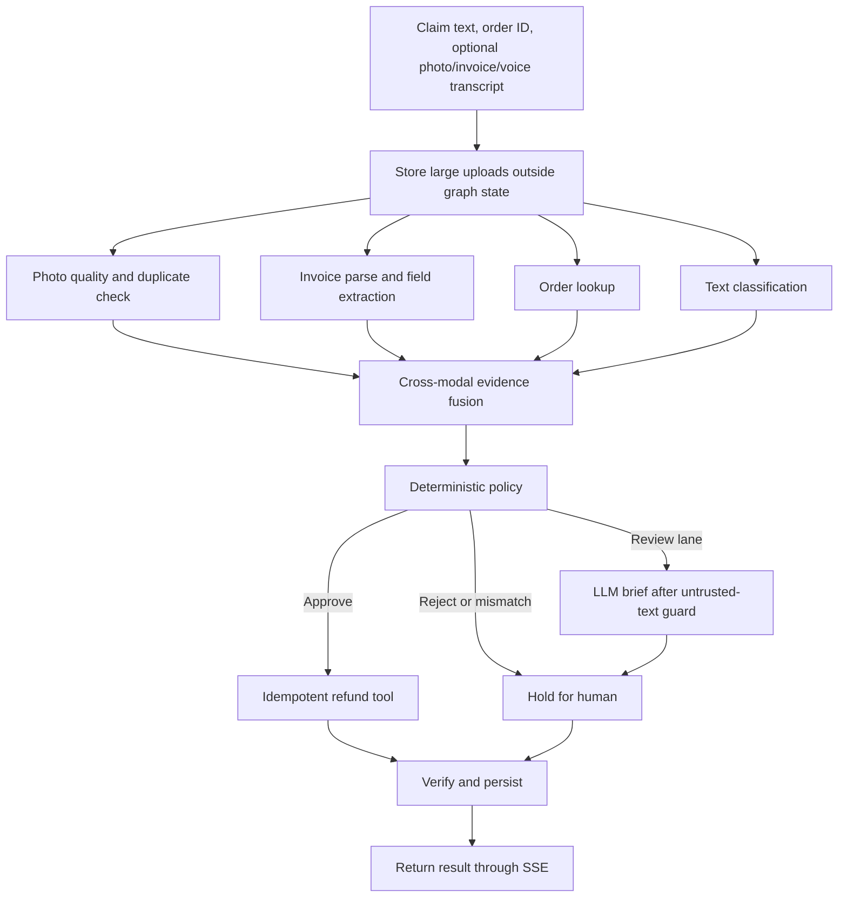

# Nyaya architecture

Nyaya separates evidence extraction, policy decisions, and customer-facing summaries. The policy engine owns the outcome. The language model is an optional reviewer aid and has no authority to approve a claim or set a refund amount.

## Components

| Component | Responsibility | Main location |
| --- | --- | --- |
| Customer and agent UI | Claim intake, voice transcript review, case console, Insights, and demo flow | `web/` |
| HTTP and event API | Claim stream, resume, tracking, search, metrics, and agent actions | `api/main.py` |
| Workflow | Parallel evidence checks, fusion, policy routing, action, and verification | `agent/graph.py` |
| Policy | Deterministic approve/reject/escalate outcome | `agent/policy.py` |
| Advisory LLM | Grounded summary for review-lane cases only | `agent/llm.py`, `agent/guard.py` |
| Tools | Order lookup, idempotent refund, and customer notification; supports MCP stdio | `agent/tools.py`, `mcp_servers/` |
| Persistence | SQLite workflow checkpoints, idempotency, event history, and FTS5 search | `api/`, `agent/tools.py` |
| ML utilities | Tabular classification/refund estimates, image quality and duplicate checks, invoice OCR | `ml/` |
| Evaluation | Synthetic regression gate, human-verified gold-set tooling, ablation, feedback slice | `eval/` |
| Delivery | Approved, allowlisted replies over webhook/SMTP; dry-run default | `agent/delivery.py` |
| Config | Validated settings, production fail-fast | `api/config.py`, `api/validate.py` |

## Component diagram

## Claim flow

## Trust and durability boundaries

- Customer text and voice transcripts are untrusted. Injection-like text is routed into review; it never instructs the policy or tools.
- Invoice/photo extraction contributes evidence only. The deterministic policy owns the decision and amount.
- Refund and notification tool calls use persistent idempotency keys so a resume cannot repeat completed actions.
- Workflow state/checkpoints and application event/search data use separate SQLite databases. Large uploads are stored under `DATA_DIR/blobs`.
- LLM findings must quote source text verbatim. Unsupported findings are dropped; model or parse failures use a deterministic brief.
- Public callers cannot supply model scores (`damage_conf`, `modalities_agree`, duplicate/repeat flags, demo switches). In production these are stripped unless `ALLOW_SCORE_OVERRIDES=1` (demo deployments with mock tools only); agent-token requests may keep them.
- Agent endpoints need `X-Agent-Token` (constant-time compare). Public endpoints are rate limited per IP; request bodies are capped (`MAX_BODY_MB`) and validated (IDs, text length, numeric ranges, base64).
- Outbound replies need agent approval, a non-dry-run `REPLY_MODE`, and an allowlisted destination; webhooks must be HTTPS and can be HMAC-signed.
- `NYAYA_ENV=production` refuses to start without a 16+ character `AGENT_TOKEN` and explicit `ALLOWED_ORIGINS`, hides `/docs`, and logs JSON lines with request IDs and no request bodies.

## Current operating limits

- Evaluation cases and tabular training data are synthetic. The metrics in the README are not real-world quality estimates.
- The optional Whisper model has not been evaluated on real Hindi, English, or Hinglish recordings.
- The CNN has no trained production weights (the pipeline is verified; see `ml/README.md`). Reply delivery is implemented but dry-run by default and untested against a live provider. Per-user roles, object storage, and distributed (multi-instance) rate limits are not implemented; the rate limiter and idempotency store are per-process/per-disk.
- Live: web https://nyaya-evidence-grounded-multimodal.vercel.app, API https://nyaya-api-i7wt.onrender.com (Render free plan: sleeps when idle, SQLite data resets on redeploy, tools are mocks).
